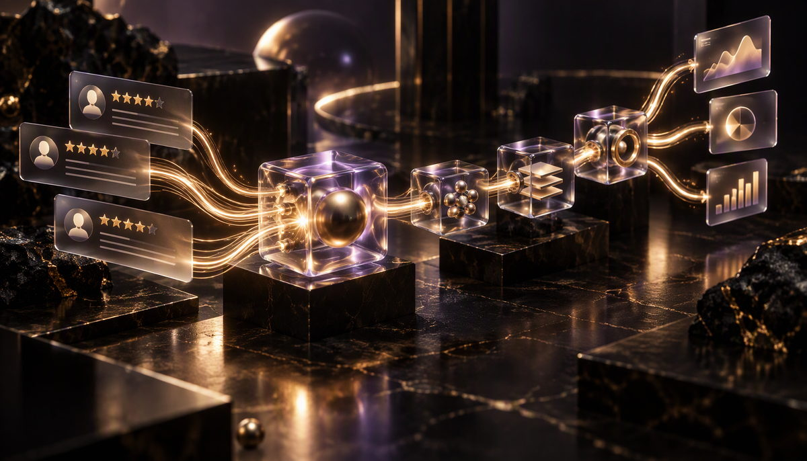
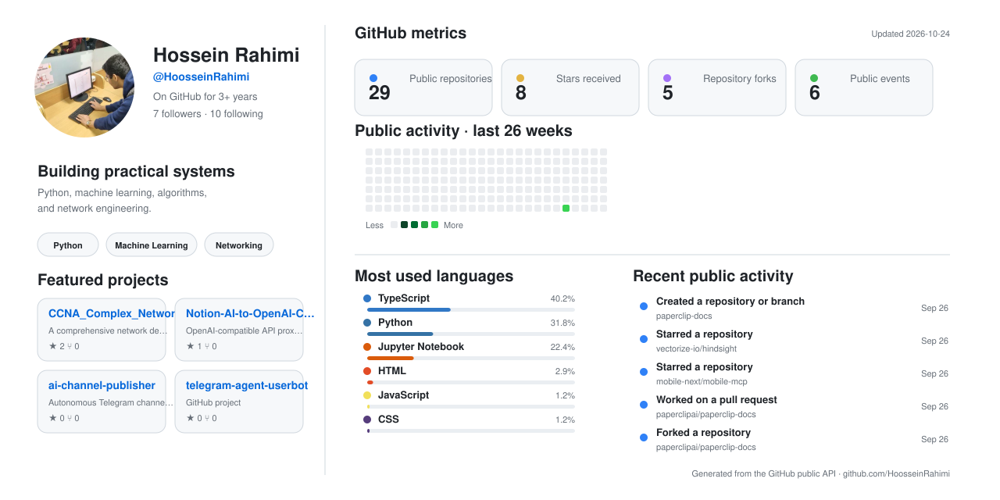

  

I build **reliable AI systems and developer tools** — clear API boundaries, security controls, and production-minded operations. My work spans governed agent workflows, LLM gateways, distributed extraction, and the backends and dashboards that keep them observable.

## Selected work

<table>
<tr>
<td width="50%" valign="top">

  
<a href="https://github.com/HoosseinRahimi/ForgeFlow-AI"><b>ForgeFlow AI</b></a> <code>v0.15.0</code> · <a href="https://hoosseinrahimi.github.io/ForgeFlow-AI/">live demo ↗</a>
 
Community edition of an AI-native project operations platform: governed copilot, repository intelligence, and <b>propose → approve → execute</b> actions.
  
  
  
</td>
<td width="50%" valign="top">

  
<a href="https://github.com/HoosseinRahimi/Notion-AI-to-OpenAI-Compatible"><b>Notion AI → OpenAI</b></a> <code>v0.4.0</code>
 
OpenAI-compatible gateway for Notion AI with SSE streaming, model aliases, concurrency controls, and hardened auth.
  
    
</td>
</tr>
<tr>
<td width="50%" valign="top">

  
<a href="https://github.com/HoosseinRahimi/ai-channel-publisher"><b>AI Channel Publisher</b></a>
 
Review-first AI publishing for Telegram: drafts, approvals, scheduling, delivery reconciliation, and analytics.
  
  
  
</td>
<td width="50%" valign="top">

  
<a href="https://github.com/HoosseinRahimi/telegram-agent-userbot"><b>Telegram AI Agent</b></a> <code>86 tests</code>
 
Allowlisted, dry-run-capable agent with PII redaction, prompt-injection boundaries, and rate-limit resilience.
  
  
  
</td>
</tr>
<tr>
<td width="50%" valign="top">

  
<a href="https://github.com/HoosseinRahimi/crawlforge"><b>CrawlForge</b></a>
 
Responsible distributed extraction: FastAPI + Celery + Playwright with SSRF defenses, quotas, and observability.
  
  
  
</td>
<td width="50%" valign="top">

  
<b>Trading Desk</b> <code>private</code>
 
Hierarchical multi-agent crypto desk where a deterministic risk engine gates every order — paper trading by default.
  
  
  
</td>
</tr>
</table>

## Live dashboard

Regenerated daily from the GitHub public API by GitHub Actions.

## More work

<table>
<tr>
<td width="33%" valign="top">

 
<a href="https://github.com/HoosseinRahimi/deutsch-rah-showcase"><b>Deutsch Rah</b></a>
 
Persian-first German learning platform with adaptive practice and an AI coach. <a href="https://deutsch-rah.vercel.app/">Live ↗</a>
</td>
<td width="33%" valign="top">

 
<b>Health &amp; Lifestyle</b> <code>private</code>
 
Local-first health platform: Android and Windows apps, FastAPI backend, and a deterministic clinical rules engine.
</td>
<td width="33%" valign="top">

 
<a href="https://github.com/HoosseinRahimi/CCNA_Complex_Network_Design"><b>CCNA Network Design</b></a>
 
Multi-area OSPF enterprise network with VLANs, NAT, DHCP, and ACLs. Scored <b>100/100</b> at MFT.
</td>
</tr>
</table>

- **[Executive Business Portfolio](https://github.com/HoosseinRahimi/executive-business-portfolio)** — bilingual EN/FA portfolio template with four themes, full RTL support, and a Pages deploy workflow.
- **Data & algorithms** — [fake-news NLP](https://github.com/HoosseinRahimi/fake-news-detection-nlp), [bulldozer price prediction](https://github.com/HoosseinRahimi/Bulldozer-price-prediction), [Airbnb EDA](https://github.com/HoosseinRahimi/airbnb-project-pandas), [Kosaraju SCC](https://github.com/HoosseinRahimi/kosaraju-algorithm), and [rat-in-maze search](https://github.com/HoosseinRahimi/Rat-in-maze).

## Open source

- **[book-to-skill](https://github.com/virgiliojr94/book-to-skill):** merged [project-local skill paths (#210)](https://github.com/virgiliojr94/book-to-skill/pull/210) and [OpenClaw skill discovery and validation (#209)](https://github.com/virgiliojr94/book-to-skill/pull/209).
- **[LiteLLM (#41376)](https://github.com/BerriAI/litellm/pull/41376):** open fix for xAI Grok-4 capability pricing.

## How I work

- **Testing** — deterministic fixtures, contract tests, an 86-test Telegram agent suite, and multi-version CI.
- **Security** — SSRF defenses, PII redaction, prompt-injection boundaries, CodeQL, and dependency review.
- **Reliability** — timeouts, retries with backoff, concurrency limits, readiness probes, and graceful shutdown.
- **Delivery** — Docker and Compose, GitHub Actions, database-backed CI, and container smoke tests.

## Toolkit

 

<table>
<tr>
<td valign="top" width="50%">
<b>AI / APIs</b> 
OpenAI-compatible APIs · Responses API · SSE streaming · tool-call guardrails · agent workflows · RAG
  
<b>Backend / data</b> 
Python · FastAPI · Node · Express · tRPC · REST · PostgreSQL · MySQL · SQLite · Drizzle · Redis
  
<b>Frontend</b> 
TypeScript · React · Vite · Tailwind CSS
</td>
<td valign="top" width="50%">
<b>Infrastructure / security</b> 
Docker · Celery · GitHub Actions · CodeQL · Linux · SSRF defenses · PII redaction
  
<b>Networking</b> 
TCP/IP · VLANs · OSPF · NAT · DHCP · ACLs
  
<b>Practices</b> 
Contract tests · reproducible fixtures · typed boundaries · observability first
</td>
</tr>
</table>

## Currently

- Building governed agent systems and production-grade LLM infrastructure.
- Open to collaboration on AI systems, developer tools, and security-heavy backends.

 
<b>Build → test → harden → observe → improve → repeat.</b>
 
© 2026 Hossein Rahimi

